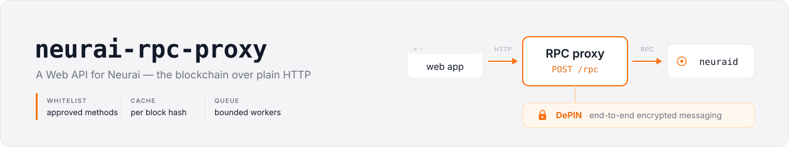

# neurai-rpc-proxy

## A Web API for Neurai

**Purpose**: make Neurai blockchain available via HTTP/WEB by exposing the RPC-API via a Proxy that only allows an explicitly approved set of methods.

Check out this software live at:

**MAIN**: https://rpc-main.neurai.org

**TESTNET**: https://rpc-testnet.neurai.org

## Features

- **Standard RPC Proxy** (`/rpc`) - Expose standard Neurai RPC calls with caching
- **DePIN Testnet support** - The proxy reaches the whitelisted `depin*` methods through the standard node RPC. DePIN protocol 2 authenticates holders with signed challenges and answers encrypted, pool-key-signed replies, so the proxy never needs to be trusted with anything
- **Smart Caching** - Cache responses based on block height to reduce node load
- **Queue Management** - Control concurrent requests to your Neurai node
- **Whitelist Protection** - Only allow an explicitly approved set of methods. Mostly reads, plus a few writes that carry their own proof (`sendrawtransaction`, `depinsubmitmsg`, `depinclearmsg`); anything needing the node's wallet or private keys stays out
- **Multi-Node Support** - Automatic failover between multiple Neurai nodes

## DePIN RPC 5

The proxy forwards the ten public messaging methods on the node's standard HTTP RPC port. Every call uses one complete request object, including bootstrap; old positional messaging arguments and RPC 2/3/4 are rejected. `depinreceiveseq` provides admission-sequence pagination. Client signing, ECIES opening and reply verification belong in `neurai-depin-msg` 4.x.

Private requests sign the target genesis, pool key/root, instance, membership revision, method and arguments. With several healthy backends, the proxy discovers their pool identities and routes only to the exact destination. It never rewrites or broadcasts a private request and never automatically retries a write. A matching backend becoming unavailable requires a fresh bootstrap/recovery on the client, not arbitrary failover.

Every reply remains the node's opaque signed wrapper. The client verifies its locally computed request hash, expected network, pinned pool and confidentiality kind before decoding or decrypting. Nothing request-bound is cached, including the public directory, bootstrap, sections and stats. Chain-only `checkdepinvalidity`, `listdepinholders`, `listdepinaddresses` and `getpubkey` keep their existing contracts.

Legacy and strict ECDSA identities are supported by the updated node, including mixed ECIES 2 messages. `depinsignrpc`, `depindecrypt`, `depinsendmsg`, `depingetmsg` and `depinpoolpkey` are local wallet helpers and are excluded from the whitelist. The removed signrequest/signchallenge helpers are not exposed either. PQ messaging and ESP32 firmware migration are separate work.

Configure a node actually containing RPC 5; a historical image/source commit does not gain it merely by updating this proxy. The existing Docker definitions retain their configured source/image choices until the operator deliberately changes them. No deployment is performed by this client migration.

Abuse control remains per origin IP (`depin_rate_limit`, default 60/minute; `depin_ban_minutes`, default 60). HTTP 429 includes `Retry-After`. Configure `trust_proxy` only for a reverse proxy you operate. The node separately validates signatures, current permissions and per-address limits.

Signed request parameters use lossless JSON, preserving cursor integers beyond 2^53 and lexical numeric tokens. Duplicate keys and numeric-object impersonation are rejected. The proxy does not manufacture pool signatures or independently prove that a directory contains only asset holders. Applications can compare against an independent chain source before sending.

See the sibling [RPC 5 integration guide](../neurai-rpc/DEPIN_IMPLEMENTATION_GUIDE_EN.md). The proxy installs the published `@neuraiproject/neurai-rpc@0.8.0` from npm, with integrity pinned in `package-lock.json`.

## How do I use this software?

When your local proxy is up and running you send requests using HTTP Post.
The body of the request should contain string **method** and array **params** 

### Example for web browser and Node.js 18+
```
//Get block count
rpc("getblockcount", []).then(function (count) {
    console.log("Block count", count);
});

//Get transactions in mempool
rpc("getrawmempool", []).then(function (data) {
    console.log("There are", data.length, "transactions in mempool right now");
});

//Get specific transaction
rpc("getrawtransaction", ["301ec56896153463576c47ac40956e58d2b9fa7de87fad39128c5ae0af66b6a4", true]).then(transaction => {
    console.log("Transaction", transaction.hash, "has", transaction.confirmations, "confirmations");
})

//Get address balance
rpc("getaddressbalance", [{ "addresses": ["NLhdtwjgrcEkRqjJZkRY4sjhkJ93EytLeE"] }]).then(balance => {
    const raw = BigInt(balance.balance);
    const sum = `${raw / 100000000n}.${(raw % 100000000n).toString().padStart(8, "0")}`;
    console.log("NLhdtwjgrcEkRqjJZkRY4sjhkJ93EytLeE balance", sum);
})


const { stringifyRpcJson } = require("@neuraiproject/neurai-rpc");

async function rpc(method, params) {
    const data = { method, params };
    const URL = 'https://xna-main.neurai.org/rpc'; //replace with your endpoint
    const response = await fetch(URL, {
        method: 'POST',
        headers: {
            'Content-Type': 'application/json'
        },
        body: stringifyRpcJson(data) // Supports bigint and rpcNumber parameters
    });
    const obj = await response.json(); // parses JSON response into native JavaScript objects 
    return obj.result;
} 
``` 
### Address types

The whitelist is by method name, so the address-taking methods accept every
address type the node knows: Legacy P2PKH (`N…`/`t…`), generic AuthScript
witness v1 (`nc1p…`/`tnc1p…`), post-quantum witness v2 (`pq1z…`/`tpq1z…`) and
ECDSA witness v3 (`nq1r…`/`tnq1r…`). Nodes that predate these address types
report them as invalid.

`validateaddress` is whitelisted and, for witness addresses, returns extra
fields: `isauthscript` (`true`), `witness_version` (`1`, `2` or `3`), `family`
(`"authscript"`, `"pq"` or `"ecdsa"`) and, for v2/v3 only, `commitment` (the
32-byte AuthScript commitment as a uint256 hex string, byte-reversed with
respect to the scriptPubKey). The node adds them in builds with wallet
support, like `ismine`/`iswatchonly`.

```
rpc("validateaddress", ["tnq1r0c9zl485wv7wcfutxfyv8k2ltpfk5hdyp3s7g4chlphx8d2m6npqwxvjya"])
// { "isvalid": true, "address": "tnq1r0c9zl…", "scriptPubKey": "53207e0a2fd4…",
//   "ismine": false, "iswatchonly": false, "isscript": false,
//   "isauthscript": true, "witness_version": 3, "family": "ecdsa",
//   "commitment": "c2d45bb5636e…" }
```

DePIN methods only work with Legacy P2PKH addresses; `getpubkey` answers for
Legacy P2PKH and AuthScript v1 addresses and rejects v2/v3 with
`Address does not refer to a key`.

## Features and limitations

This software lives up to parts of the JSON-RPC 2.0 Specification
https://www.jsonrpc.org/specification

According to JSON-RPC 2.0 a request object could contain four attributes, jsonrpc, method, params and id.
- This software only supports **method** and **params**.
- This software does NOT support **id**
- This software hardcodes **jsonrpc** to "2.0"
- This sofware does NOT support batch calls.

## How to install
```
git clone https://github.com/neuraiproject/neurai-rpc-proxy.git
cd neurai-rpc-proxy
npm install 
```

### Docker

Two stacks, one per network, each with its own `.env`:

```
cd docker/mainnet        # or docker/testnet
cp .env.example .env     # ports and RPC credentials shared by node and proxy
docker compose up -d
```

`.env` is ignored by git, so your values survive a `git pull`; `.env.example` is the
template that changes when a new variable appears. Every variable has the same
default in the compose file, so a stack also starts without a `.env`.

- **mainnet** pulls `neuraiproject/neurai-node:v1.0.6` from Docker Hub. The image
  writes `/data/neurai.conf` from its `NEURAI_*` variables **on the first start only**
  and keeps it in the volume, so changing a value in `.env` later does not reach a
  node that already has its file. To apply one, delete the file and restart; the
  entrypoint regenerates it: `docker compose exec neuraid rm /data/neurai.conf &&
  docker compose restart neuraid`. The proxy, by contrast, re-reads `.env` on every
  `up -d`, so keep both in step. The node runs as the unprivileged user `neurai`
  (uid 999); the RPC and ZMQ ports stay inside the compose network.
- **testnet** builds the `DePIN-Test` branch with `docker/node/Dockerfile` and the
  env-driven `entrypoint.sh` next to it; see the DePIN section above. Set
  `NODE_SOURCE_COMMIT` to the audited node commit and rebuild the image when
  the node source changes. The current default is `0fe5a74943210508ec3be34c78e0f9192b7fefec`.

**Reset testnet deployment:** use a fresh node data volume. The previous
testnet data directory has a different genesis and cannot be reused by
reindexing. Back up the old volume first. If the DePIN pool identity must stay
the same, restore the dedicated wallet and rescan it on the new chain; verify
the resulting `depingetmsginfo.depinpoolpkey` against the existing client pin.
Do not copy `depinpool.dat` into the new volume, since it contains messages
from the previous chain. Rebuild the node image with the intended
`NODE_SOURCE_COMMIT`, then check `getblockhash 0` and `getnetworkinfo`
directly on the node before routing traffic. The testnet proxy expects genesis
`0000008b384aeffecdab182575dc4e86c9f07f90318c65088532660ed9a8a021`;
it answers 503 if no configured node matches. The proxy exposes the read-only
`getnetworkinfo` method so C6 wallets can obtain the node's `relayfee` for sponsor
recovery; this method is not cached. C6 additionally requires the node to report
`getblockchaininfo.zk_portable_tree.active_for_next_block = true`. Reset testnet
activates C6 at block 100; deploy a node revision that includes this schedule.
Mining control and network-management RPC methods remain outside the public whitelist.

**Upgrading a mainnet node from the v1.0.5 image:** its data directory was
`/data/node`; v1.0.6 uses `/data` and the volume keeps the old layout, so without a
move the new node would resync from scratch. Once, with the stack stopped:

```
docker compose down
docker run --rm -v neurai-wallet-rpc-mainnet_neurai_data_mainnet:/data alpine sh -c \
  'cd /data && for f in node/* node/.[!.]*; do [ -e "$f" ] && mv "$f" .; done; \
   rmdir node; rm -f neurai.conf .lock; chown -R 999:999 /data'
docker compose up -d
```

The old `neurai.conf` is dropped on purpose (it was a read-only bind mount, only an
empty mount point may be left behind) so the image generates the new one from `.env`.

### How do I configure this software?
Configure your setup in ./config.json

**Standard configuration:**
```json
{
    "concurrency": 4,
    "endpoint": "https://rpc-main.neurai.org/rpc",
    "environment": "Neurai",
    "expected_genesis": "00000044d33c0c0ba019be5c0249730424a69cb4c222153322f68c6104484806",
    "local_port": 19999,
    "nodes": [
      {
        "name": "Node number 1",
        "username": "dauser",
        "password": "dapassword",
        "neurai_url": "http://localhost:19001"
      }
    ]
}
```

**Configuration Options:**
- `concurrency` - Number of concurrent requests to handle
- `endpoint` - Public endpoint URL (displayed in UI)
- `environment` - Environment name (displayed in UI)
- `expected_genesis` - Required 64-character genesis block hash; only healthy nodes
  on this chain serve requests. Use the reset testnet hash shown above for testnet.
- `local_port` - Port for the proxy server
- `nodes` - Array of Neurai nodes for failover
  (`depin_enabled` / `depin_url` from 1.1.x are obsolete and ignored — DePIN goes through `neurai_url`)
- `depin_rate_limit` - `depin*` requests allowed per origin IP and minute (default 60, 0 disables)
- `depin_ban_minutes` - How long an IP that exceeded the limit is blocked (default 60)
- `trust_proxy` - Express `trust proxy` setting; enable only behind a trusted reverse proxy that sets `X-Forwarded-For`

### How should my Neurai node be configured?

**For standard RPC:**
```
server=1 
listen=1

# Full transaction index
txindex=1

# Address index (needed for getaddress* calls)
addressindex=1

# Asset index (needed for getassetdata)
assetindex=1

# Timestamp index
timestampindex=1

# Maintains the full Spent index on your node. Default is 0.
spentindex=1

# Username and password - set secure username/password
rpcuser=secret
rpcpassword=secret

# What IP address is allowed to make calls to the RPC server.
rpcallowip=127.0.0.1

dbcache=4096
```

For an RPC 5 testnet node, set `depinmsg=1` and `depinmsgtoken`, keep the
wallet enabled, and optionally tune `depinratelimit` (the compose file does this
through environment variables). There is no DePIN port: the service is served on the RPC port
the proxy already talks to. The stable `v1.0.6` mainnet node does not accept these
options.

## Sir, how do I start this application?

```
npm start
```

## Help with Neurai RPC calls, arguments and stuff
Go to https://xna-main.neurai.org/ for in depth description of each RPC call


## List of Neurai RPC calls
This is a raw list, a lot of these calls are not whitelisted.
For example we do NOT let developers call procedure `dumpprivkey`
```
== Addressindex ==
getaddressbalance
getaddressdeltas
getaddressmempool
getaddresstxids
getaddressutxos

== Assets ==
getassetdata "asset_name"
getcacheinfo 
getsnapshot "asset_name" block_height
issue "asset_name" qty "( to_address )" "( change_address )" ( units ) ( reissuable ) ( has_ipfs ) "( ipfs_hash )"
issueunique "root_name" [asset_tags] ( [ipfs_hashes] ) "( to_address )" "( change_address )"
listaddressesbyasset "asset_name" (onlytotal) (count) (start)
listassetbalancesbyaddress "address" (onlytotal) (count) (start)
listassets "( asset )" ( verbose ) ( count ) ( start )
listmyassets "( asset )" ( verbose ) ( count ) ( start ) (confs) 
purgesnapshot "asset_name" block_height
reissue "asset_name" qty "to_address" "change_address" ( reissuable ) ( new_units) "( new_ipfs )" 
transfer "asset_name" qty "to_address" "message" expire_time "change_address" "asset_change_address"
transferfromaddress "asset_name" "from_address" qty "to_address" "message" expire_time "rvn_change_address" "asset_change_address"
transferfromaddresses "asset_name" ["from_addresses"] qty "to_address" "message" expire_time "rvn_change_address" "asset_change_address"

== Blockchain ==
clearmempool
decodeblock "blockhex"
getbestblockhash
getblock "blockhash" ( verbosity ) 
getblockchaininfo
getblockcount
getblockdeltas "blockhash"
getblockhash height
getblockhashes timestamp
getblockheader "hash" ( verbose )
getchaintips
getchaintxstats ( nblocks blockhash )
getdifficulty
getibdstatus
getmempoolancestors txid (verbose)
getmempooldescendants txid (verbose)
getmempoolentry txid
getmempoolinfo
getrawmempool ( verbose )
getspentinfo
gettxout "txid" n ( include_mempool )
gettxoutproof ["txid",...] ( blockhash )
gettxoutsetinfo
preciousblock "blockhash"
pruneblockchain
savemempool
verifychain ( checklevel nblocks )
verifytxoutproof "proof"

== Control ==
getinfo
getmemoryinfo ("mode")
getrpcinfo
help ( "command" )
stop
uptime

== Generating ==
generate nblocks ( maxtries )
generatetoaddress nblocks address (maxtries)
getgenerate
setgenerate generate ( genproclimit )

== Messages ==
clearmessages 
sendmessage "channel_name" "ipfs_hash" (expire_time)
subscribetochannel 
unsubscribefromchannel 
viewallmessagechannels 
viewallmessages 

== Mining ==
getblocktemplate ( TemplateRequest )
getkawpowhash "header_hash" "mix_hash" nonce, height, "target"
getmininginfo
getnetworkhashps ( nblocks height )
pprpcsb "header_hash" "mix_hash" "nonce"
prioritisetransaction <txid> <dummy value> <fee delta>
submitblock "hexdata"  ( "dummy" )

== Network ==
addnode "node" "add|remove|onetry"
clearbanned
disconnectnode "[address]" [nodeid]
getaddednodeinfo ( "node" )
getconnectioncount
getnettotals
getnetworkinfo
getpeerinfo
listbanned
ping
setban "subnet" "add|remove" (bantime) (absolute)
setnetworkactive true|false

== Rawtransactions ==
combinerawtransaction ["hexstring",...]
createrawtransaction [{"txid":"id","vout":n},...] {"address":(amount or object),"data":"hex",...}
decoderawtransaction "hexstring"
decodescript "hexstring"
fundrawtransaction "hexstring" ( options )
getrawtransaction "txid" ( verbose )
sendrawtransaction "hexstring" ( allowhighfees )
signrawtransaction "hexstring" ( [{"txid":"id","vout":n,"scriptPubKey":"hex","redeemScript":"hex"},...] ["privatekey1",...] sighashtype )
testmempoolaccept ["rawtxs"] ( allowhighfees )

== Restricted assets ==
addtagtoaddress tag_name to_address (change_address) (asset_data)
checkaddressrestriction address restricted_name
checkaddresstag address tag_name
checkglobalrestriction restricted_name
freezeaddress asset_name address (change_address) (asset_data)
freezerestrictedasset asset_name (change_address) (asset_data)
getverifierstring restricted_name
issuequalifierasset "asset_name" qty "( to_address )" "( change_address )" ( has_ipfs ) "( ipfs_hash )"
issuerestrictedasset "asset_name" qty "verifier" "to_address" "( change_address )" (units) ( reissuable ) ( has_ipfs ) "( ipfs_hash )"
isvalidverifierstring verifier_string
listaddressesfortag tag_name
listaddressrestrictions address
listglobalrestrictions
listtagsforaddress address
reissuerestrictedasset "asset_name" qty to_address ( change_verifier ) ( "new_verifier" ) "( change_address )" ( new_units ) ( reissuable ) "( new_ipfs )"
removetagfromaddress tag_name to_address (change_address) (asset_data)
transferqualifier "qualifier_name" qty "to_address" ("change_address") ("message") (expire_time) 
unfreezeaddress asset_name address (change_address) (asset_data)
unfreezerestrictedasset asset_name (change_address) (asset_data)

== Restricted ==
viewmyrestrictedaddresses 
viewmytaggedaddresses 

== Rewards ==
cancelsnapshotrequest "asset_name" block_height
distributereward "asset_name" snapshot_height "distribution_asset_name" gross_distribution_amount ( "exception_addresses" ) ("change_address") ("dry_run")
getdistributestatus "asset_name" snapshot_height "distribution_asset_name" gross_distribution_amount ( "exception_addresses" )
getsnapshotrequest "asset_name" block_height
listsnapshotrequests ["asset_name" [block_height]]
requestsnapshot "asset_name" block_height

== Util ==
createmultisig nrequired ["key",...]
estimatefee nblocks
estimatesmartfee conf_target ("estimate_mode")
signmessagewithprivkey "privkey" "message"
validateaddress "address"
verifymessage "address" "signature" "message"

== Depin asset ==
checkdepinvalidity
closedepin "asset_name" ( "change_address" )
depingetancestorrecipients
freezedepin
getpubkey
listdepinaddresses
listdepinholders
opendepin "asset_name" ( "change_address" )
sealdepin "asset_name" ( "change_address" )
selfrevokedepin
unfreezedepin

== DePIN messaging (RPC 5; node catalog, not the public whitelist) ==
depinchallenge
depinclearmsg
depingetmsg
depingetmsginfo
depinlistsections
depinmcpstatus
depinpoolpkey
depinpoolstats
depinreceivemsg
depinreceiveseq
depinsendmsg
depinsignrpc  # LOCAL WALLET ONLY
depindecrypt
depinsubmitmsg

== Wallet ==
abandontransaction "txid"
abortrescan
addmultisigaddress nrequired ["key",...] ( "account" )
addwitnessaddress "address"
backupwallet "destination"
bumpfee has been deprecated on the XNA Wallet.
dumpextkeypq
dumpprivkey "address"
dumpwallet "filename"
encryptwallet "passphrase"
exportxpqpub count ( chain offset )
getaccount "address"
getaccountaddress "account"
getaddressesbyaccount "account"
getbalance ( "account" minconf include_watchonly )
getmasterkeyinfo
getmywords ( "account" )
getnewaddress ( "account" "address_type" )
getrawchangeaddress ( "address_type" )
getreceivedbyaccount "account" ( minconf )
getreceivedbyaddress "address" ( minconf )
gettransaction "txid" ( include_watchonly )
getunconfirmedbalance
getwalletinfo
importaddress "address" ( "label" rescan p2sh )
importmulti "requests" ( "options" )
importprivkey "privkey" ( "label" ) ( rescan )
importprunedfunds
importpubkey "pubkey" ( "label" rescan )
importwallet "filename"
keypoolrefill ( newsize )
listaccounts ( minconf include_watchonly)
listaddressgroupings
listlockunspent
listpqaddresses
listreceivedbyaccount ( minconf include_empty include_watchonly)
listreceivedbyaddress ( minconf include_empty include_watchonly)
listsinceblock ( "blockhash" target_confirmations include_watchonly include_removed )
listtransactions ( "account" count skip include_watchonly)
listunspent ( minconf maxconf  ["addresses",...] [include_unsafe] [query_options])
listwallets
lockunspent unlock ([{"txid":"txid","vout":n},...])
move "fromaccount" "toaccount" amount ( minconf "comment" )
removeprunedfunds "txid"
rescanblockchain ("start_height") ("stop_height")
sendfrom "fromaccount" "toaddress" amount ( minconf "comment" "comment_to" )
sendfromaddress "from_address" "to_address" amount ( "comment" "comment_to" subtractfeefromamount replaceable conf_target "estimate_mode")
sendmany "fromaccount" {"address":amount,...} ( minconf "comment" ["address",...] replaceable conf_target "estimate_mode")
sendtoaddress "address" amount ( "comment" "comment_to" subtractfeefromamount replaceable conf_target "estimate_mode")
setaccount "address" "account"
settxfee amount
signmessage "address" "message"
walletlock
walletpassphrase "passphrase" timeout
walletpassphrasechange "oldpassphrase" "newpassphrase"

```

## Exact numeric transport (1.2.1)

The proxy now requires neurai-rpc >= 0.7.0. It preserves large integers and exact
fractional amounts from the node. Safe values remain JSON numbers; unsafe
values are returned as decimal strings, including nested XNA and asset fields
and cached results. Clients must keep these strings or use bigint for raw
integer units rather than converting them to Number.

Incoming JSON numeric parameters are parsed without rounding and forwarded as
numeric tokens. Quoted strings remain strings. For JavaScript clients, use
`stringifyRpcJson` with bigint or `rpcNumber("100000000.00000001")` when forming
requests. JSON.stringify of an already rounded number cannot recover its digits.
Cache keys preserve the distinction between numeric tokens and quoted strings.

Rebuild/restart the deployed proxy to activate this update. Updating a client
library alone cannot recover digits already rounded by an older proxy.

## Published RPC 5 dependency

This checkout uses the published `@neuraiproject/neurai-rpc@0.8.0`. Run `npm ci` before starting or testing; `package-lock.json` pins the registry tarball and its SHA-512 integrity. Docker installs the same dependency from the lockfile. No local package archives are required.
